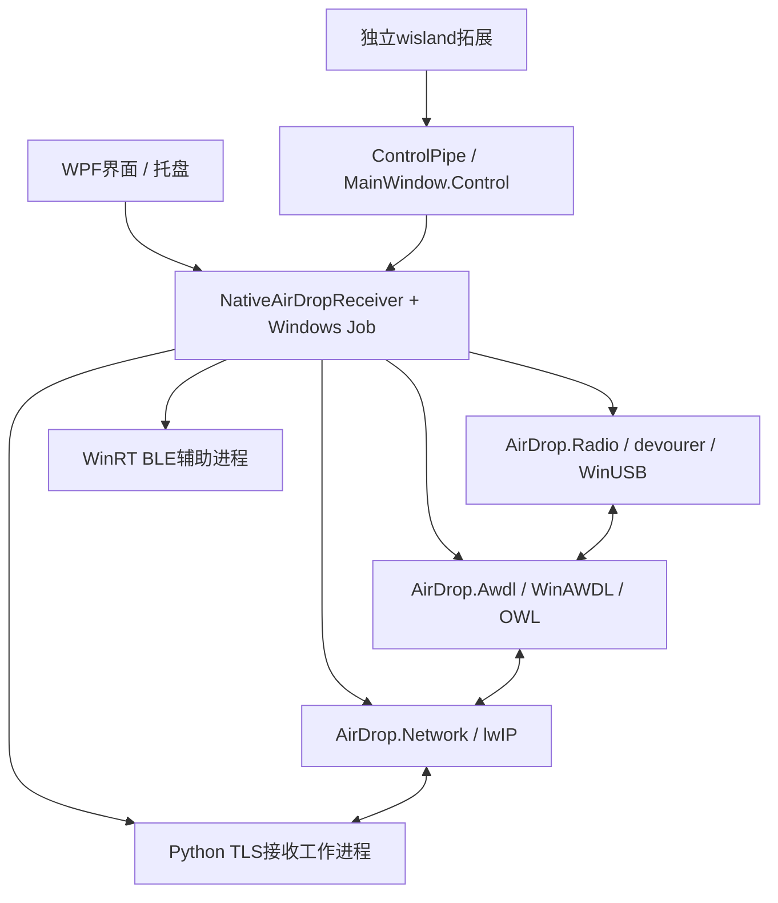

# AirDrop 接收端开发文档

更新：2026-11-17。代码入口为本仓库；显示名称 AirDrop，程序集版本0.2.0，目录和命名空间仍为LiquidGlassWinAirDrop。

## 项目边界与开始阅读

接收端仓库：<https://github.com/h3049928398-stack/airdrop-windows>。灵动岛界面独立维护于[wisland-connectivity-extension](https://github.com/h3049928398-stack/wisland-connectivity-extension)。两者通过[本机控制协议](CONTROL_PROTOCOL.md)连接，不共享Python环境，不复制第二条USB/AWDL接收链。

先读README、AGENTS、[当前交接](HANDOFF.md)、[队列](WORK_QUEUE.md)及[验证记录](VALIDATION.md)。`integrations/wisland`是提取前快照，后续拓展修改应在独立仓库完成。`archive/DropBridge`不属于本仓库和构建依赖，禁止复用其代码、补丁或二进制。

## 模块与调用关系



| 位置 | 职责与修改入口 |
| --- | --- |
| `src/LiquidGlassWinAirDrop/App.xaml.cs` | 单实例、启动/自检参数、首个窗口及数据目录 |
| `MainWindow.xaml*`、`ViewModel.cs` | WPF界面、托盘及状态绑定 |
| `ControlPipe.cs`、`MainWindow.Control.cs` | 当前用户IPC、异步命令、十分钟截止时间和请求委托 |
| `NativeAirDropReceiver.cs`、`WorkerJob.cs` | 工作进程启动/监督/停止、逐次确认与父进程退出清理 |
| `Storage.cs`、`WindowsStartup.cs` | 设置/真实文件目录、自启动注册与回滚 |
| `LiquidMaterial.cs`、`LiquidNavigation.cs`、`MaterialChecks.cs` | 仅应用内容采样的导航玻璃、折射和材质检查 |
| `Hardware.cs` | SetupAPI硬件/驱动状态检查；读取状态不等于无线互通 |
| `native/radio` | 指定0BDA:C811的USB工作进程；不能泛化到其他网卡后直接运行 |
| `native/awdl`、`native/common` | 独立WinAWDL/OWL适配、原始帧/管道收发 |
| `native/stack` | 用户态IPv6/TCP/UDP、mDNS和本地TLS字节桥 |
| `backend/receiver_worker.py`、`backend/beacon.ps1` | 接收协议包装、每次确认与BLE辅助发现 |
| `tools/`、`docs/native.lock.json` | 固定依赖恢复、原生编译、引擎打包及许可清单 |

TLS只监听本机回环18771；AWDL上的8771经用户态桥转入，不创建系统TUN或修改防火墙。请求需明确批准，45秒未回答默认拒绝。完整设计见[架构](ARCHITECTURE.md)。

## 环境与从克隆开始构建

Windows x64；GUI需要.NET 10 SDK，运行需要.NET 10 Desktop Runtime。项目使用WPF/WinForms，`NuGet.Config`清空外部包源，当前没有第三方NuGet包。原生构建另需Visual Studio C++工具、Git、CMake/Ninja；脚本通过默认位置的vswhere找到VS自带工具，AWDL使用锁定的LLVM-MinGW。

独立克隆没有父工作区的Build-AirDrop.ps1，应使用仓库自带入口：

```powershell
git clone https://github.com/h3049928398-stack/airdrop-windows.git
cd airdrop-windows
.\build.ps1 -Preview
```

默认输出`dist/AirDrop`，构建后运行基础检查，`-Preview`另执行预览及窗口检查。只有GUI时，未打包引擎必须如实显示不可接收。

恢复并构建完整引擎：

```powershell
.\tools\Restore-Sources.ps1 -WithBuildDependencies
.\tools\Build-Native.ps1
```

Restore-Sources按`native.lock.json`克隆独立上游、校验提交/子模块/下载SHA256；遇到已有变更会停止，不覆盖。Build-Native编译三个工作进程，运行5个原生测试后调用Package-Engine。上游源码在`upstream`，工具/缓存在`.build`，均不进Git。首次依赖下载和原生构建耗时较长；尚未完成完全空白机器的全链恢复验收。

在现有AirDrop工作区，唯一运行入口仍是`runtime/AirDrop/AirDrop.exe`。退出托盘中的宿主后，使用父目录入口，避免生成另一份活动运行版：

```powershell
..\Build-AirDrop.ps1 -Preview
..\Build-AirDrop.ps1 -Native
```

独立`build.ps1`、Build-Native和Package-Engine均支持`-OutputDirectory`；指定路径时三者应一致。不要在宿主占用文件时覆盖运行包，不覆盖`data`。先编译/检查，再由用户明确的更新操作切换运行文件。

## 验证命令与证据分级

以下用独立克隆输出路径示例；现有工作区替换为唯一运行目录。报告路径应使用新名字，保留原始成功与失败记录。

```powershell
.\dist\AirDrop\AirDrop.exe --self-test .\artifacts\self-test-new.json
.\dist\AirDrop\AirDrop.exe --ui-check .\artifacts\ui-check-new.json
.\dist\AirDrop\AirDrop.exe --startup-registration-check .\artifacts\startup-new.json
.\dist\AirDrop\AirDrop.exe --startup-check .\artifacts\startup-ui-new.json
.\dist\AirDrop\AirDrop.exe --engine-check .\artifacts\engine-new.json
```

基础检查17项、窗口检查8项、隔离注册表检查5项、隐藏启动检查10项、本地协议集成检查6项为已有基线。engine-check需要已打包backend，包含本地合成通信/归档，不是手机传输；报告会创建隔离检查目录。不同诊断之间不要并行抢占协议测试端口。

硬件只读检查为`AirDrop.exe --diagnose <JSON>`、`backend/AirDrop.Radio.exe --probe`。`--receive`、Radio的`--run`/`--listen`及BLE脚本可能启动射频，不能作为普通构建检查自动执行。真实发现/传输必须由手机发起并确认，单独记录设备、时间、结果、实际字节数和本地哈希；没有源文件哈希时不声称端到端哈希一致。

## 开发和变更规则

1. UI改动维持小巧右下窗口、四栏和既定材质，不把纯透明叠层当真实折射。
2. 改IPC先更新CONTROL_PROTOCOL，保持管道v1兼容并验证拓展；命令受理不等于启动/传输完成。
3. 改进程生命周期必须验证无所属工作进程的临时对象不会发送全局停止，父退出时Job清理仍有效。
4. 原生协议改变保持固定来源、ABI、许可证和工作进程边界；不要直接编辑研究副本代替本仓库适配层。
5. 为实际改动运行适当检查，记录源码/编译/软件/硬件/真实传输的不同证据；文档变更只需核对源码、命令和链接，不以旧测试冒充重新硬件验证。

## 配置、恢复和发行

运行目录`data/preferences.json`为设置，`data/keys`为身份/证书，`data/logs`为日志；用户自选接收目录可在运行目录之外。它们均不进Git，不随更新或恢复删除。自启动只改当前用户Run下自身值；`--startup`只隐藏启动，不自动RF。

驱动恢复按[DRIVER_RUNBOOK](DRIVER_RUNBOOK.md)，不要对其他网卡或安全设置操作。硬件异常先保存日志/PCAP并正常停止，不能通过删密钥或清空接收目录重置问题。

本仓库NOTICE声明原创部分MIT，但根LICENSE文本目前缺失；第三方组件许可各异，见[THIRD_PARTY](THIRD_PARTY.md)。完整运行包不能统一称MIT。补齐授权文本、GPL/LGPL对应源码义务、固件再分发依据、运行库条款和代码签名之前，仓库保持私有，不把本机包当公开正式发行物。
